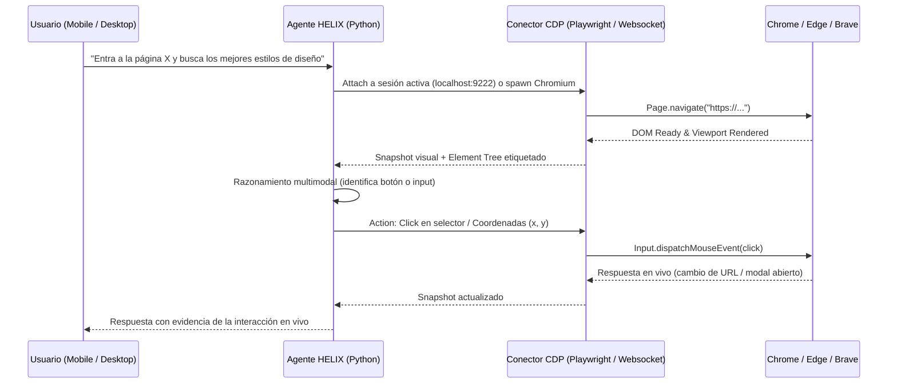

# Arquitectura de Navegación Activa en Tiempo Real (Live Browser Control)

## Objetivo
Permitir que HELIX no solo lea páginas de forma estática o tome capturas pasivas, sino que **interactúe en vivo y en tiempo real con el navegador** (mover cursor, hacer clicks en elementos, escribir en campos, desplazarse, resolver formularios y extraer respuestas dinámicas en pantalla) tal como lo hacen Claude Computer Use o ChatGPT Browser Agent.

---

## 1. Estado Actual vs. Arquitectura Requerida

| Característica | Estado Actual | Arquitectura Activa Requerida |
|---|---|---|
| **Modo de conexión** | Extensión local pasiva (`browser-extension-bridge.ts`, puerto 47831) | Chrome DevTools Protocol (**CDP**) bidireccional sobre WebSocket + Playwright |
| **Control de Cursor & Clics** | Inactivo / Solo lee snapshot del DOM | Inyección de eventos `Input.dispatchMouseEvent` en coordenadas exactas |
| **Escritura en tiempo real** | Inactiva | Eventos `Input.dispatchKeyEvent` y `type(selector, text)` |
| **Feedback en Vivo** | Solo devuelve texto tras petición | Streaming de capturas visuales / screencast a Desktop y Mobile (`Page.startScreencast`) |
| **Ejecución en navegador del usuario** | Dependía de pestaña con extensión | Conexión directa a instancia activa de Chrome/Edge con flag `--remote-debugging-port=9222` |

---

## 2. Flujo de Ejecución en Vivo

---

## 3. Componentes Técnicos a Integrar

1. **Launcher del Navegador con Puerto de Depuración:**
   - Script o comando de Electron para abrir Google Chrome / Edge con:
     `chrome.exe --remote-debugging-port=9222 --user-data-dir="<ruta_perfil_helix>"`
   - Permite que el usuario navegue con su sesión habitual o que HELIX tome control directo sin instalar extensiones de terceros.

2. **Módulo de Acciones Autónomas en `services/agent/browser/`:**
   - `browser_tool.py`:
     - `click(selector_or_coords)`
     - `type_text(selector, text, delay_ms)`
     - `scroll(direction, amount)`
     - `hover(selector)`
     - `press_key(key)`
     - `capture_viewport()` (para validar visualmente el efecto del click)

3. **Loop de Agente Reactivo (Perception-Action Loop):**
   - El agente recibe la orden, toma captura, decide el siguiente click/tecla, lo ejecuta, verifica el resultado y continúa hasta cumplir el objetivo.
