<div align="center">

# HELIX

### The Persistent, Local-First AI Desktop Assistant for Windows

HELIX is a local-first desktop agent that works with your operating system, terminal, and the context you choose to share; it asks for confirmation before system-level or critical actions.

[Website](https://helix-assistant.vercel.app) | [Downloads](https://helix-assistant.vercel.app/download) | [Features](https://helix-assistant.vercel.app/features) | [Docs](https://helix-assistant.vercel.app/docs) | [Releases](https://github.com/joelpizza0818-blip/Helix-Assitant/releases) | [FAQ](FAQ.md) | [Support](SUPPORT.md) | [Security](SECURITY.md)

[](https://helix-assistant.vercel.app/download)
[](https://github.com/joelpizza0818-blip/Helix-Assitant/releases)
[](https://github.com/joelpizza0818-blip/Helix-Assitant/actions/workflows/test-quality.yml)
[](https://github.com/joelpizza0818-blip/Helix-Assitant/actions/workflows/test-multiplatform.yml)
[](https://www.npmjs.com/package/helix-assistant-cli)
[](LICENSE)

</div>

<!-- TODO: Add a current screenshot or short, real end-to-end GIF under docs/assets/ after verifying the flow on a release build. -->

## What HELIX does

- **Chat and act:** request supported desktop, terminal, file, and browser tasks; Windows workflows include shell commands, file operations, and desktop controls.
- **Stay in control:** inspect and approve actions that require system or critical permissions.
- **Choose an AI provider:** configure supported cloud providers or local model endpoints, with provider-key fallback where configured; credentials and provider access are your responsibility.
- **Extend HELIX:** add reviewable Markdown skills and opt-in local MCP servers.
- **Keep useful context:** use local session memory and the Context Compression Layer (CCL) to pack large tool outputs and retrieve their stored originals.
- **Choose a shell:** HELIX Normal (Electron), Lite (Tauri), the Android mobile companion, or CLI. Official desktop installers are currently available for Windows x64 only.

<!-- HELIX-DATA:model-summary:start -->
The repository catalog contains **54 entries** across 8 provider identifiers: `anthropic` (7), `free` (6), `google` (9), `groq` (5), `llama_server` (1), `ollama` (8), `openai` (10), `openrouter` (8). These are configured catalog entries, not a guarantee of provider access or successful live requests. See [config/model-catalog.json](config/model-catalog.json).
<!-- HELIX-DATA:model-summary:end -->

Tool availability depends on permissions, provider configuration, operating system, and hardware.

## See HELIX in action

Click any preview to play the video from the live landing page.

<table>
  <tr>
    <td align="center"><strong>Desktop conversation</strong><br><a href="https://helix-assistant.vercel.app/assets/video%201%20-%20helix-SCEFlWXd.mp4">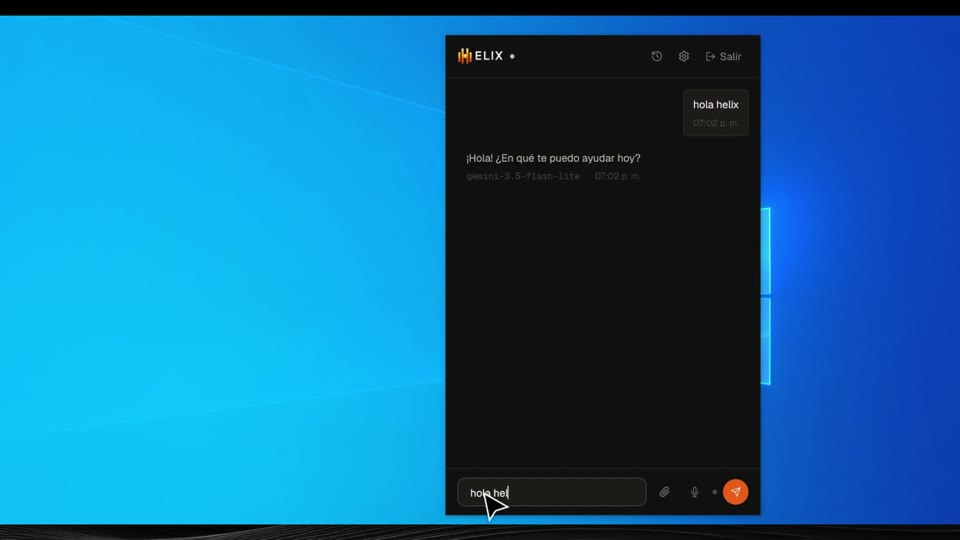</a></td>
    <td align="center"><strong>Voice and calls</strong><br><a href="https://helix-assistant.vercel.app/assets/video%202%20-%20helix-BtrdAcgh.mp4">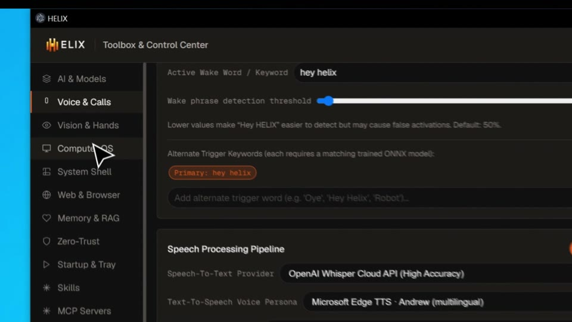</a></td>
  </tr>
  <tr>
    <td align="center"><strong>Skills editor</strong><br><a href="https://helix-assistant.vercel.app/assets/video%203%20-helix-BgcdftHO.mp4">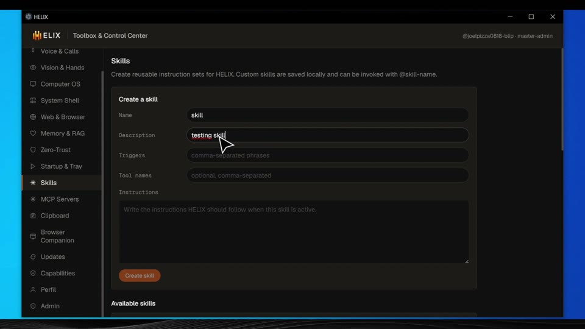</a></td>
    <td align="center"><strong>Desktop agent chat</strong><br><a href="https://helix-assistant.vercel.app/assets/video%204%20-%20helix-CD9FteH8.mp4">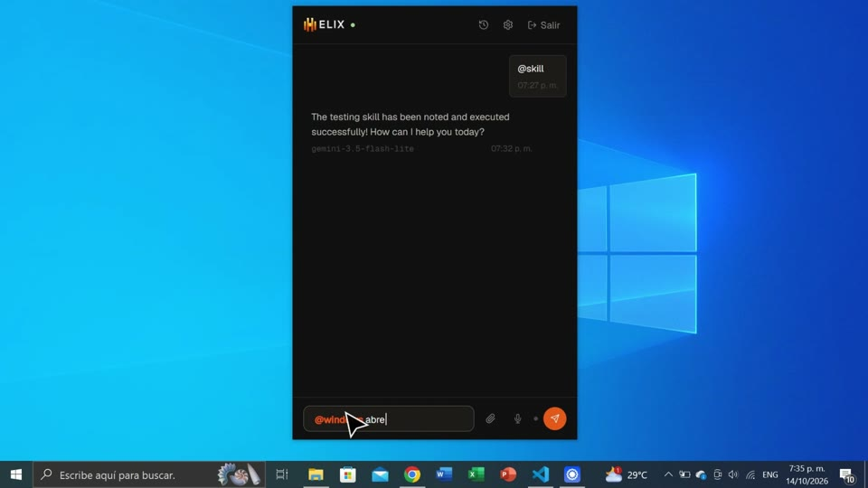</a></td>
  </tr>
  <tr>
    <td align="center"><strong>CLI connection</strong><br><a href="https://helix-assistant.vercel.app/assets/helix%20cli%201-B0vC0arT.mp4">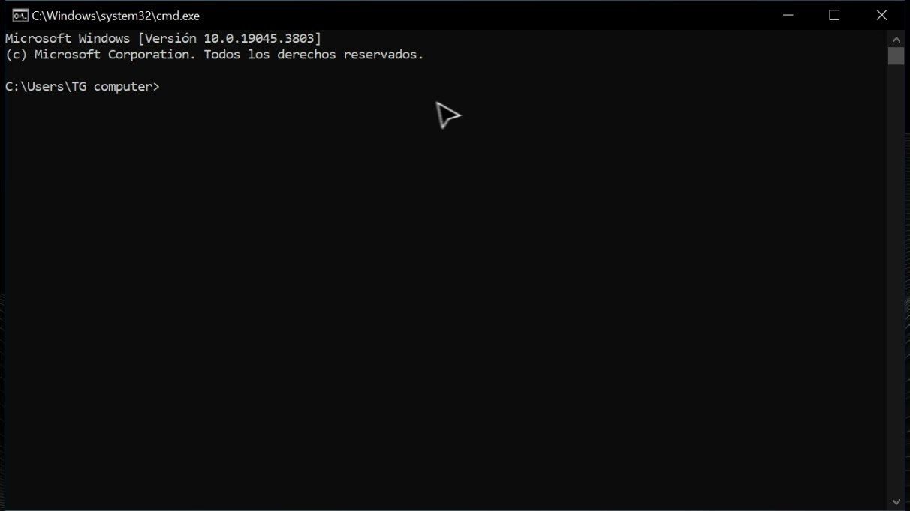</a></td>
    <td align="center"><strong>CLI prompt flow</strong><br><a href="https://helix-assistant.vercel.app/assets/helix%20cli%202-YYY4HHO5.mp4"></a></td>
  </tr>
  <tr>
    <td align="center"><strong>CLI task execution</strong><br><a href="https://helix-assistant.vercel.app/assets/helix%20cli%203-v_157PS2.mp4">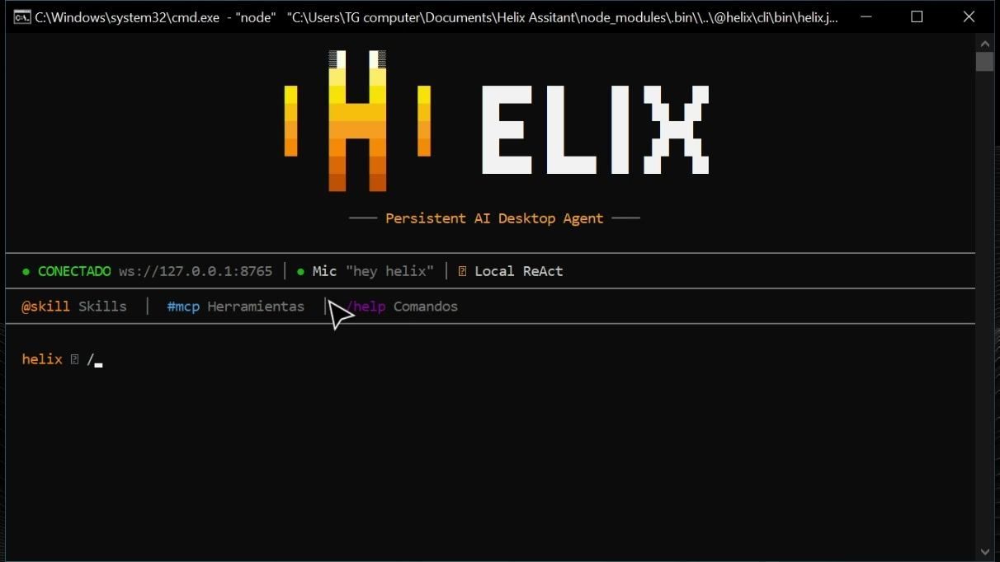</a></td>
    <td></td>
  </tr>
</table>

## Quick tour

<table align="center">
  <tr>
    <td width="50%" align="center">
      <strong>Natural desktop interaction</strong><br><br>
      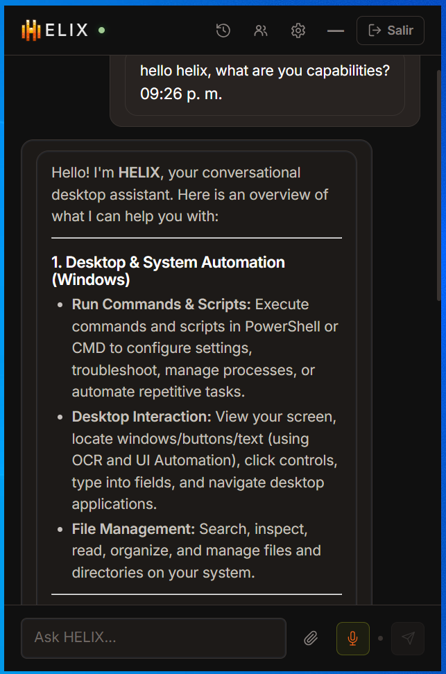
      <p align="left"><em>Use chat to request supported desktop, terminal, file, and browser tasks, with confirmation for sensitive actions.</em></p>
    </td>
    <td width="50%" align="center">
      <strong>Provider key failover</strong><br><br>
      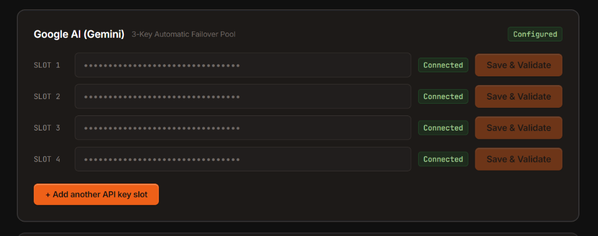
      <p align="left"><em>Configure provider keys and failover behavior for the AI services you choose to use.</em></p>
    </td>
  </tr>
</table>

## Live landing performance snapshot

Measured against the production landing page on **2026-11-05 UTC** with the repository's [k6 scenario](tests/k6/landing-load-test.js): 2 virtual users for 10 seconds, 12 iterations, and 48 HTTP requests.

| Production measurement | Observed |
|---|---:|
| HTTP response time (median / p95 / max) | 110 ms / 276 ms / 712 ms |
| Failed HTTP requests | 0 / 48 |
| Critical HTML, JavaScript, and CSS response bodies | 611,433 bytes (597 KiB) |
| Single browser navigation (DOMContentLoaded / FCP / load event) | 1.88 s / 2.08 s / 31.50 s* |
| Browser-recorded resource transfer | 714,464 bytes |

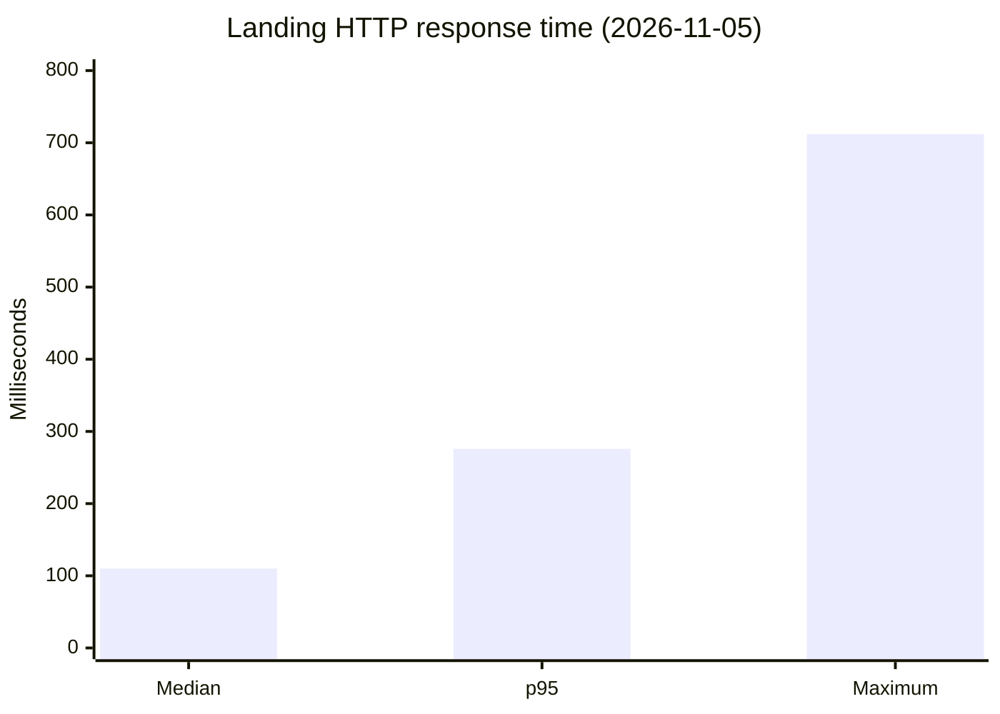

Gallery videos are opened on demand rather than eagerly downloaded on first load. *The browser timings are from one navigation; its 31.50 s load event is unexplained (no individual recorded resource exceeded 1.2 s), and LCP was unavailable. Repeat from independent locations before attributing a cause. These observations are not real-user telemetry or a desktop CPU/memory benchmark. Results vary with network, region, cache, and deployment.

## Download

<!-- HELIX-DATA:download-rows:start -->
| Product | Platform | Public release / download | Status |
|---|---|---|---|
| HELIX Normal | Windows x64 | [v0.7.0](https://github.com/joelpizza0818-blip/Helix-Assitant/releases/tag/v0.7.0) / [Download page](https://helix-assistant.vercel.app/download) | Public release published; no installer asset is attached. Use the authenticated download page. |
| HELIX Lite | Windows x64 | [lite-v0.7.0](https://github.com/joelpizza0818-blip/Helix-Assitant/releases/tag/lite-v0.7.0) | Published with Windows installer and SHA-256 sidecar. |
| HELIX Mobile | Android APK | [mobile-v0.7.0](https://github.com/joelpizza0818-blip/Helix-Assitant/releases/tag/mobile-v0.7.0) | Published with four APK variants and SHA-256 sidecars. |
| HELIX CLI | Node.js / npm | [npm package](https://www.npmjs.com/package/helix-assistant-cli) | npm latest 0.6.1; repository source is 0.7.0. |
<!-- HELIX-DATA:download-rows:end -->

The Windows desktop installers are not Authenticode-signed, so SmartScreen may show a warning. Verify the SHA-256 published with the artifact before running it. Official desktop installers are currently available for Windows x64 only; Linux and macOS desktop installers are not published.

## Quick start

### Desktop

1. Open the [download page](https://helix-assistant.vercel.app/download) and sign in if prompted.
2. Download the Windows x64 installer and compare its SHA-256 with the checksum provided for that release.
3. Start HELIX and configure a cloud provider or local model in settings.

### CLI

Run without a global install:

```powershell
npx helix-assistant-cli@latest
```

Or install it globally:

```powershell
npm install --global helix-assistant-cli
helix
```

<!-- HELIX-DATA:cli-version:start -->
npm's current `latest` version is **0.6.1**; the repository source package is **0.7.0**. The `/subagents` and `/browser live` commands require version **0.5.0 or newer**.
<!-- HELIX-DATA:cli-version:end -->

### From source (Windows PowerShell)

The repository's release workflows use Node.js 24 and Python 3.11 for the agent; the minimum supported Node.js version for local development is not declared. Rust and Cargo are needed to build HELIX Lite.

```powershell
git clone https://github.com/joelpizza0818-blip/Helix-Assitant.git
Set-Location Helix-Assitant
npm ci
npm run dev:desktop
```

## How it works

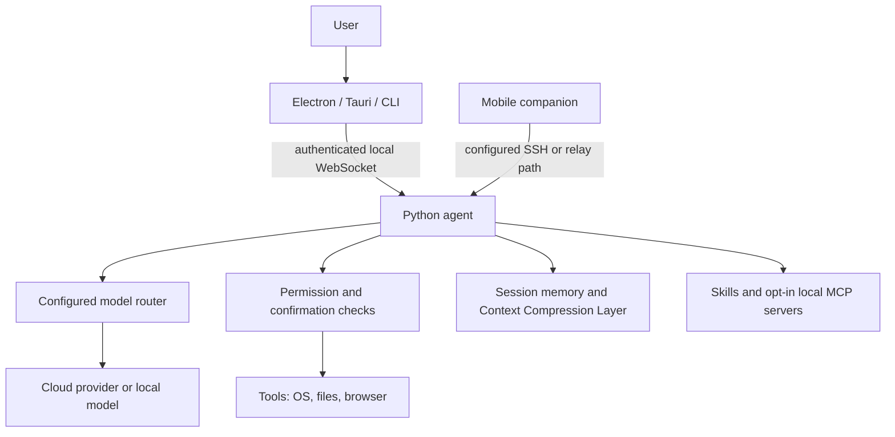

The separate web/API services are not part of the local desktop-to-agent request path. See [docs/ARCHITECTURE.md](docs/ARCHITECTURE.md) for boundaries and contracts.

## Context packing and retrieval

Large outputs are represented in the model context by a compact summary and a content-derived ID. The original text is gzip-compressed and retained for selective retrieval; blocks at least 5 MiB before compression spill to a temporary file.

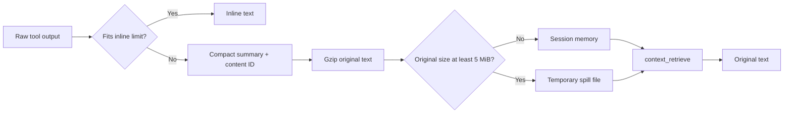

| Folder | Responsibility |
|---|---|
| `apps/desktop/` | Electron desktop shell and renderer |
| `apps/desktop-tauri/` | Tauri desktop Lite shell |
| `apps/cli/` | npm terminal client |
| `movil/` | Flutter mobile companion |
| `services/agent/` | Python agent, tools, providers, permissions, and memory |
| `services/relay-worker/` | Cloudflare relay worker |
| `server/` | Express API and Prisma database boundary |
| `apps/landing/` | Public website, downloads, features, and privacy pages |
| `config/` | Shared configuration, including the model catalog |
| `docs/` | Architecture, environment, and project-flow documentation |
| `scripts/` | Build, validation, and documentation tooling |

## Security and privacy

HELIX classifies tool operations as `READ_ONLY`, `LOW_RISK`, `MODIFY`, `EXECUTE`, `SYSTEM`, or `CRITICAL`. Policies are action-specific; system and critical operations require human confirmation before execution. Confirmation checks do not replace operating-system permissions.

The agent runs locally, but prompts and context you provide—including selected screen content—may be sent to the configured AI provider. Remote speech services, account/download flows, and other enabled integrations may also send data to their respective services. Credentials can come from the operating-system keyring or the agent environment; never share logs or configuration files without checking them for sensitive data.

Read the [HELIX privacy policy](https://helix-assistant.vercel.app/privacy) and [architecture and permission behavior](docs/ARCHITECTURE.md) before enabling integrations. Data handling and retention also depend on each configured service.

## Configuration

| Area | Common variables |
|---|---|
| Database | `DATABASE_URL`, `DIRECT_URL` |
| Supabase | `SUPABASE_URL`, `SUPABASE_ANON_KEY`; `SUPABASE_SERVICE_ROLE_KEY` is server-only |
| AI providers | `OPENAI_API_KEY_*`, `ANTHROPIC_API_KEY_*`, `GOOGLE_API_KEY_*` |
| Agent | `AGENT_WS_PORT`, `LOG_LEVEL`, `LOG_FILE` |

See [docs/ENVIRONMENT.md](docs/ENVIRONMENT.md) for the full configuration reference. Do not commit `.env` files, API keys, tokens, or signing credentials.

## Troubleshooting

- **The agent does not connect:** make sure the desktop app is running; the local WebSocket defaults to port `8765`. Check the application logs and confirm that local security software is not blocking the process.
- **A tool is missing or unavailable:** check the active shell, permission policy, selected provider/model capabilities, and any required OS or hardware access. MCP servers and skills must be configured.
- **Voice or camera does not work:** check OS/device permissions, the selected voice or vision settings, and the required optional model/dependencies. Remote speech providers may require credentials and network access.

## Development and testing

The main repository checks are:

```powershell
npm test
npm run test:agent
npm run docs:check
```

See [CONTRIBUTING.md](CONTRIBUTING.md) for the complete testing command list and contribution workflow, [docs/RELEASING.md](docs/RELEASING.md) for channel releases, and [docs/PROJECT_FLOW.md](docs/PROJECT_FLOW.md) for request and build flow.

## Project status

<!-- HELIX-DATA:project-status:start -->
Normal 0.7.0: published (no installer asset on the public release); Lite 0.7.0: published; Android 0.7.0: published; CLI npm latest 0.6.1 (repository source 0.7.0).
<!-- HELIX-DATA:project-status:end -->

## License

HELIX is distributed under the [MIT License](LICENSE).
