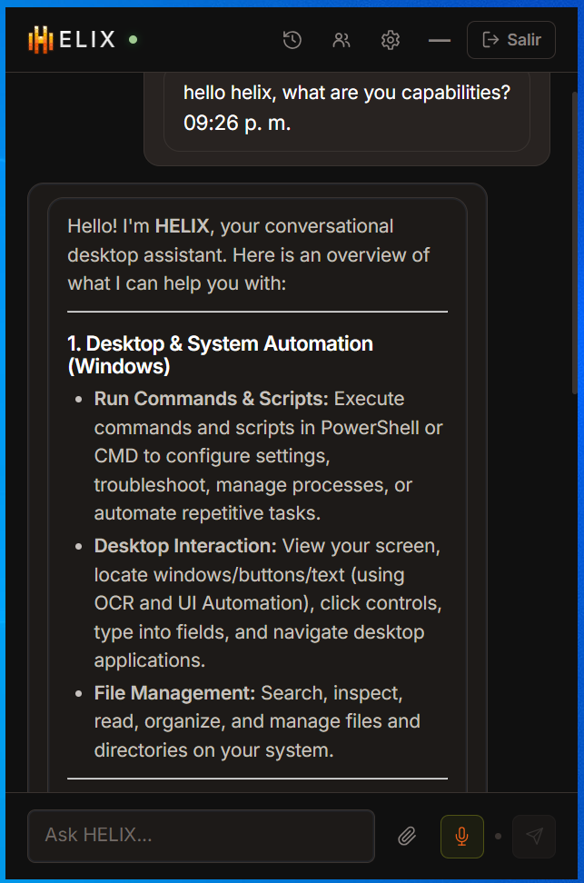
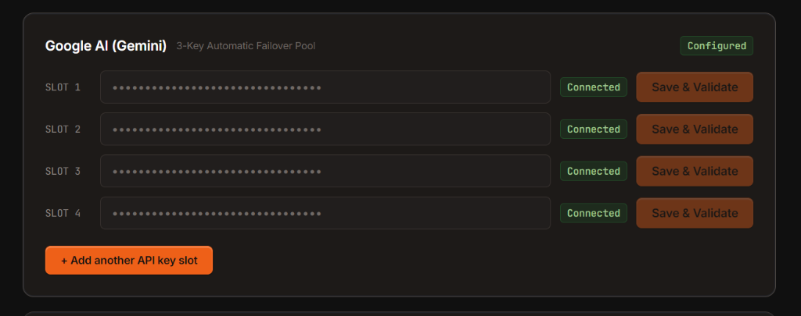
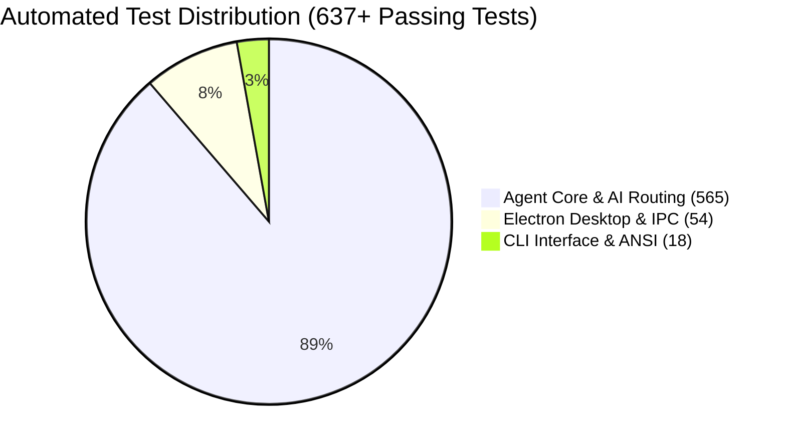
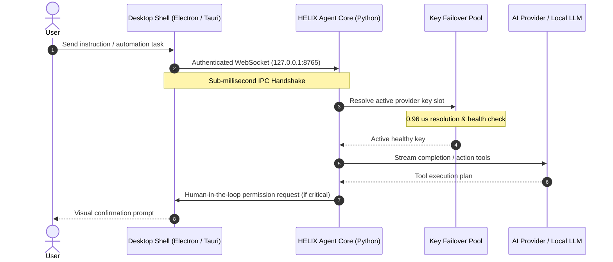

<div align="center">

# HELIX

### The Persistent, Local-First AI Desktop Assistant for Windows

[](https://helix-assistant.vercel.app/download)
[](https://github.com/joelpizza0818-blip/Helix-Assitant/releases)
[](https://www.npmjs.com/package/helix-assistant-cli)
[](https://github.com/joelpizza0818-blip/Helix-Assitant/actions)
[](#context-compression--memory-efficiency)
[](LICENSE)

<p align="center">
  <b>Conversational AI meets real OS automation.</b><br/>
  Control your desktop, manage files, automate workflows, and switch seamlessly between 50+ cloud and local AI models with human-in-the-loop safety controls.
</p>

[**Website & Live Demo**](https://helix-assistant.vercel.app) • [**Download Desktop**](https://helix-assistant.vercel.app/download) • [**CLI Guide**](#terminal-cli) • [**Benchmarks & Testing**](#verified-benchmarks--test-metrics) • [**Architecture**](docs/ARCHITECTURE.md)

</div>

---

## HELIX by the Numbers

Real figures verified through automated integration, unit, and performance test suites across the monorepo:

```
┌─────────────────────┬─────────────────────┬─────────────────────┬─────────────────────┐
│     637+ Tests      │       0.96 us       │       99.9%         │      54 Models      │
│  Passing contracts  │ Key failover check  │  Log token savings  │   Active catalog    │
└─────────────────────┴─────────────────────┴─────────────────────┴─────────────────────┘
```

- **637+ Automated Tests:** 565 agent unit/integration tests, 54 Electron/IPC contract tests, and 18 CLI end-to-end tests passing without regressions.
- **Sub-microsecond Key Failover:** Evaluation taking 0.964 microseconds per operation ensures zero perceived latency when rotating saturated API keys.
- **99.9% Token Context Compression:** High-volume system and CLI logs compress from ~100 KB to ~115 bytes inline, saving context window space while preserving instant on-demand retrieval (< 0.25 ms).
- **54 AI Models Supported:** Production-ready out of the box with Claude 3.7 Sonnet, GPT-4o, Gemini 2.0 Flash, DeepSeek-R1, and local GGUF / Ollama models.

---

## 30-Second Quick Tour

HELIX bridges state-of-the-art LLMs with native Windows capabilities, giving your AI hands to interact with your system while keeping complete privacy and security under your control.

<table align="center">
  <tr>
    <td width="50%" align="center">
      <b>Natural Desktop Interaction & Execution</b><br/><br/>
      
      <p align="left"><i>Chat with HELIX to run PowerShell/CMD scripts, automate UI actions via OCR and UI Automation, inspect local files, and trigger agentic sub-tasks.</i></p>
    </td>
    <td width="50%" align="center">
      <b>Multi-Slot Failover & Key Resiliency</b><br/><br/>
      
      <p align="left"><i>Never run out of quota: Configure automated multi-key failover pools for Gemini, OpenAI, Anthropic, OpenRouter, and local models (Ollama and Llama Server).</i></p>
    </td>
  </tr>
</table>

---

## Verified Benchmarks & Test Metrics

### 1. Test Coverage Across Ecosystem



| Component | Test Suite | Tests | Result | Latency / Scope |
|---|---|---|---|---|
| **services/agent** | Pytest (`python -m pytest`) | **565 passed** | Passed | Memory, Skills, Perception, Model routing, MCP |
| **apps/desktop** | Node Test Runner (`npm test`) | **54 passed** | Passed | IPC handshake, extension bridge, token security |
| **apps/cli** | CLI Suite (`cli.test.ts`) | **18 passed** | Passed | ANSI rendering, autocomplete, subagents, piped UTF-8 |
| **apps/landing** | Vite / TS (`vite build`) | **115 modules** | Passed | Production bundle in 14.85s |

---

### 2. Context Compression & Memory Efficiency

The **Context Compression Layer (CCL)** minimizes prompt token overhead by packing verbose terminal output, structured code, and multi-line logs into lightweight references with exact lossless retrieval:

```mermaid
xychart-beta
    title "Context Window Impact: Raw vs Packed (Characters)"
    x-axis ["System Log (1.5k lines)", "Process Table (1k rows)", "API Payload Block"]
    y-axis "Characters" 0 --> 100000
    bar [97889, 72000, 45000]
    bar [115, 72107, 280]
```



- **Verbose Logs:** 97,889 characters compressed to **115 characters** (**99.9% reduction**), packed in 2.78 ms, retrieved losslessly in 0.20 ms.
- **Process Tables:** Structured chunking with fast gzip-backed memory stores and automatic disk-spill for datasets exceeding 1 MB.

---

### 3. Architecture & Latency Profile



---

## Key Features

- **Native Windows Automation:** Run scripts (PowerShell, CMD), manage background processes, inspect files, and interact with desktop windows using accessibility APIs and computer vision.
- **Smart Browser Control:** Pair your browser with the official HELIX extension to inspect live web elements, automate forms, and execute complex web research workflows with protected connection handling.
- **Intelligent Model Routing & Key Pools:** Support for 50+ models (Claude 3.7 Sonnet, GPT-4o, Gemini 2.0 Flash, DeepSeek-R1, and local GGUF/Ollama). Built-in multi-key failover pool prevents downtime.
- **Human-in-the-Loop Security:** Clear permission boundaries (Read-only, Moderate, System, Critical). Sensitive system actions require explicit confirmation.
- **MCP & Skill Ecosystem:** Fully compatible with Model Context Protocol (MCP) servers (stdio) and reviewable Markdown skills to extend capabilities dynamically.
- **Multi-Platform Companion Ecosystem:**
  - **HELIX Desktop Normal:** Full-featured Electron shell with complete diagnostics and native tooling.
  - **HELIX Desktop Lite:** Ultralight Tauri/Rust shell optimized for minimal memory and instant startup.
  - **HELIX CLI:** Interactive terminal interface with live command execution and real-time ANSI stream feedback.
  - **HELIX Mobile Companion:** Remote monitoring and relay client for Android.

---

## Getting Started

### 1. HELIX Desktop (Recommended)

Download the installer directly for Windows 10/11:

1. Head over to [**helix-assistant.vercel.app/download**](https://helix-assistant.vercel.app/download).
2. Grab the latest installer:
   - **HELIX Normal (Electron):** Includes all native dependencies and built-in Python runtime.
   - **HELIX Lite (Tauri):** Fast, resource-efficient shell.
3. Launch HELIX and set up your preferred AI model provider or local model.

### 2. Terminal CLI

Experience HELIX directly from any terminal on Windows, macOS, or Linux:

```bash
# Run immediately with npx
npx helix-assistant-cli

# Or install globally
npm install --global helix-assistant-cli
helix
```

> **CLI Commands:**
> - `/models`: Switch between active AI models and providers.
> - `/subagents`: Inspect active subagents and task progress.
> - `/browser live on`: Toggle terminal-based visual snapshots for browser tasks.

---

## Installation from Source

For developers looking to contribute or run local development builds:

### Prerequisites
- Node.js 20+ & npm
- Python 3.11+
- Rust & Cargo (only if building HELIX Lite Tauri shell)
- Windows 10 or 11 (for native Windows automation features)

### Setup & Run

```powershell
# Clone the repository
git clone https://github.com/joelpizza0818-blip/Helix-Assitant.git
cd Helix-Assitant

# Install all workspace dependencies
npm ci

# Launch desktop app in development mode
npm run dev:desktop
```

### Common Commands

| Command | Description |
|---|---|
| `npm run dev:desktop` | Run Electron desktop app in development mode |
| `npm run dev:desktop-tauri` | Run Lite Tauri desktop app in development mode |
| `npm run dev:landing` | Run landing page and documentation locally |
| `npm run build:desktop` | Package the desktop application |
| `npm test` | Run full test suite (lint, models, workspace tests) |
| `npm run test:agent` | Run Python agent pytest suite |

---

## Security & Privacy Philosophy

- **Local Execution First:** Tasks, file modifications, and OS operations run strictly on your machine.
- **Zero Silent Privileges:** Sensitive operations (deleting files, executing shell commands, modifying registry/system paths) prompt for explicit user confirmation.
- **API Key Safety:** Keys are securely stored locally and never broadcasted to external servers beyond the designated AI model endpoints.

---

## Release Matrix

| Distribution Channel | Version | Platform | Status |
|---|---|---|---|
| **HELIX Desktop Normal** | `v0.7.0` | Windows x64 | Published release on GitHub / installer workflow |
| **HELIX Desktop Lite** | `lite-v0.7.0` | Windows x64 | [Available on GitHub](https://github.com/joelpizza0818-blip/Helix-Assitant/releases/tag/lite-v0.7.0) |
| **HELIX Mobile** | `mobile-v0.7.0` | Android (ARM64, APK) | [Available on GitHub](https://github.com/joelpizza0818-blip/Helix-Assitant/releases/tag/mobile-v0.7.0) |
| **HELIX CLI** | `0.7.0` (npm: `0.6.1`) | Cross-platform | [npm package](https://www.npmjs.com/package/helix-assistant-cli) |

---

## Contributing

We welcome contributions! Please see our [Contributing Guide](CONTRIBUTING.md) and check [open issues](https://github.com/joelpizza0818-blip/Helix-Assitant/issues).

1. Fork the repo and create your feature branch: `git checkout -b feature/amazing-feature`.
2. Commit your changes: `git commit -m 'feat: add amazing feature'`.
3. Push to the branch: `git push origin feature/amazing-feature`.
4. Open a Pull Request.

---

## License

Distributed under the MIT License. See `LICENSE` for more information.
