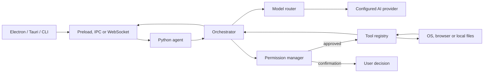
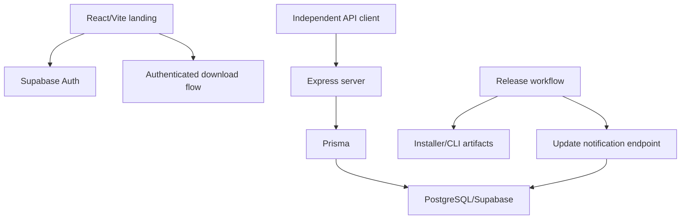

# HELIX Project Flow

This document explains how a request moves through HELIX and how source becomes a tested release. The local desktop channel and the independent HTTP server are separate systems.

## Runtime flow



## Request lifecycle

1. Text, voice, or gesture produces a request.
2. The desktop shell validates and forwards it through the preload/IPC or local WebSocket contract.
3. The agent creates a task, session context, and lifecycle events.
4. The orchestrator chooses direct conversation, planning, delegation, or a tool call.
5. The model router selects only configured models that satisfy required capabilities.
6. The permission manager denies, requests confirmation, or authorizes execution.
7. The tool executes with validated arguments and a sanitized environment.
8. The result is returned to context; large content may be stored by the Context Compression Layer.
9. Events travel back to the shell and update messages, tasks, approvals, and status.

## Service boundaries



The renderer is not assumed to call the Express API. Any integration must be explicit in code and documented with its authentication and failure behavior.

## Development flow

```text
Read vault/context → inspect contracts → implement focused change
        ↓
unit tests + typecheck + encoding + build
        ↓
manual browser/hardware/service checks when applicable
        ↓
review diff → update docs/evidence → merge/release
```

Useful commands:

```powershell
npm run dev:desktop
npm run dev:landing
npm run dev:server
npm run build:windows
npm run build:server
npm test
```

## Release flow

1. Confirm the version, lockfiles, changelog/release notes, and migration state.
2. Run encoding, catalog, type, unit, build, Promptfoo, and k6 checks appropriate to the change.
3. Inspect the final diff and confirm no secrets or generated artifacts are staged.
4. Apply database migrations from the approved production environment before code paths depend on them.
5. Create the product and Lite tags from a clean commit.
6. Publish installers, checksums, CLI package, and landing metadata through their workflows.
7. Run authenticated readiness, download, updater, and controlled SMTP checks.
8. Record evidence and unresolved limits in the vault.

## Artifact pipeline

- `build:agent-runtime` packages the Python runtime for desktop distribution.
- `build:desktop` compiles TypeScript/Vite and creates the Electron installer.
- `build:landing` produces the public Vite site.
- `build:server` creates the Express server artifact.
- `stage:windows-installer` stages installer data outside public static assets.
- Release workflows upload or publish artifacts according to their configured repository and secrets.

## Evidence standard

Report each result as one of: automated, static, manual, installation, hardware, or external-service evidence. A passing build does not prove SMTP delivery, camera access, an installed updater, or Search Console indexing.
